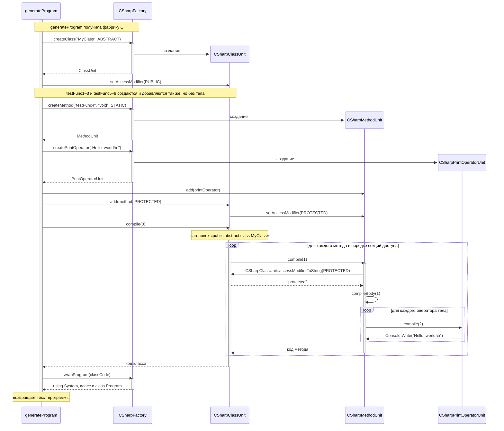

# Документация к лабораторной работе: генерация кода

Консольное приложение на C++, генерирующее исходный код класса на C++, C# и Java. Разработано в рамках курса «Технологии программирования» (4 курс, 2 семестр).

## Описание

Программа строит дерево элементов кода (класс → методы → операторы) и по нему генерирует законченную программу на каждом из трёх языков. Целевой язык определяется не на этапе компиляции, а во время выполнения — выбором конкретной фабрики. Для решения задачи применён паттерн «Абстрактная фабрика».

Исходный код генератора из задания размещён первым коммитом репозитория.

## Требования по заданию

1. Расширить исходную реализацию, чтобы генерировать программы не только на C++, но и на C# и Java.
2. Сгенерированные программы должны без ошибок компилироваться компилятором своего языка.
3. Добавить модификаторы классов и методов, которых нет в C++, но есть в C# и Java (`synchronized`, `transient`, `volatile` можно не включать).
4. Применить паттерн «Абстрактная фабрика».

## Технологии

- C++17
- CMake 3.16
- MinGW-w64 (GCC)

## Структура проекта

```
code_generator/
├── main.cpp               точка входа: generateProgram и генерация на трёх языках
├── unit.h                 базовый элемент синтаксиса Unit
├── classunit.h            абстрактный элемент «класс»
├── methodunit.h           абстрактный элемент «метод»
├── printoperatorunit.h    абстрактный элемент «оператор печати»
├── factory.h              абстрактная фабрика Factory
├── cppfactory.h/.cpp      элементы и фабрика C++
├── csharpfactory.h/.cpp   элементы и фабрика C#
├── javafactory.h/.cpp     элементы и фабрика Java
├── docs/                  исходники UML-диаграмм (.mmd)
└── tests/                 эталоны и тест-кейсы
```

## Архитектура

- Абстрактные элементы
  - `Unit` — базовый элемент: `add` (добавление вложенного элемента), `compile` (генерация кода), модификатор доступа элемента
  - `ClassUnit` — класс: члены, сгруппированные по модификаторам доступа, и модификаторы класса
  - `MethodUnit` — метод: имя, тип, модификаторы и тело
  - `PrintOperatorUnit` — оператор печати строки
- Абстрактная фабрика
  - `Factory` — интерфейс создания элементов (`createClass`, `createMethod`, `createPrintOperator`) и обёртки программы (`wrapProgram`, `fileName`)
- C++: `CppFactory`, `CppClassUnit`, `CppMethodUnit`, `CppPrintOperatorUnit`
- C#: `CSharpFactory`, `CSharpClassUnit`, `CSharpMethodUnit`, `CSharpPrintOperatorUnit`
- Java: `JavaFactory`, `JavaClassUnit`, `JavaMethodUnit`, `JavaPrintOperatorUnit`

### Абстрактная фабрика

Функция `generateProgram(const Factory&)` собирает дерево элементов только через интерфейс `Factory` и абстрактные элементы и **не знает целевого языка**. Конкретная фабрика создаёт элементы своего языка, а каждый элемент сам генерирует код в синтаксисе этого языка:

| Фабрика         | Создаёт элементы | Обёртка программы                          | Файл           |
|-----------------|------------------|--------------------------------------------|----------------|
| `CppFactory`    | `Cpp*`           | `#include <cstdio>` и `int main()`         | `MyClass.cpp`  |
| `CSharpFactory` | `CSharp*`        | `using System;` и `class Program { Main }` | `MyClass.cs`   |
| `JavaFactory`   | `Java*`          | -                                          | `MyClass.java` |

Чтобы добавить новый язык, достаточно создать наследников `ClassUnit`, `MethodUnit`, `PrintOperatorUnit` и `Factory` и добавить фабрику в `main`; `generateProgram` при этом не меняется.

### Модификаторы

Флаги задаются один раз для всех языков; каждый элемент переводит их в синтаксис своего языка, а модификаторы, которых в языке нет, отбрасывает.

**Модификаторы доступа** (`ClassUnit::AccessModifier`) — для членов класса и для самого класса (`setAccessModifier`):

| Флаг                 | C++          | C#                   | Java            |
|----------------------|--------------|----------------------|-----------------|
| `PUBLIC`             | `public:`    | `public`             | `public`        |
| `PROTECTED`          | `protected:` | `protected`          | `protected`     |
| `PRIVATE`            | `private:`   | `private`            | `private`       |
| `INTERNAL`           | `public:`    | `internal`           | package-private |
| `PROTECTED_INTERNAL` | `protected:` | `protected internal` | `protected`     |
| `PRIVATE_PROTECTED`  | `protected:` | `private protected`  | `private`       |

**Модификаторы класса** (`ClassUnit::Modifier`):

| Флаг       | C++     | C#         | Java       |
|------------|---------|------------|------------|
| `ABSTRACT` | -       | `abstract` | `abstract` |
| `FINAL`    | `final` | `sealed`   | `final`    |

**Модификаторы метода** (`MethodUnit::Modifier`):

| Флаг       | C++                        | C#         | Java       |
|------------|----------------------------|------------|------------|
| `STATIC`   | `static`                   | `static`   | `static`   |
| `CONST`    | `const`                    | -          | -          |
| `VIRTUAL`  | `virtual`                  | `virtual`  | - (методы виртуальны по умолчанию) |
| `ABSTRACT` | `virtual ... = 0`          | `abstract` | `abstract` |
| `FINAL`    | `final` (только у virtual) | -          | `final`    |

Добавлены по заданию (в C++ их нет): `internal`, `protected internal`, `private protected` (C#), package-private (Java), модификатор доступа у класса, `abstract` у класса и метода, `sealed` у класса (C#).

## Сборка

### CMake

```bash
mkdir build && cd build
cmake ..
cmake --build .
```

## Использование

```bash
./code_generator
```

Программа печатает сгенерированный код на трёх языках в консоль и сохраняет его в папку `generated` текущего каталога (`MyClass.cpp`, `MyClass.cs`, `MyClass.java`). Входные данные генерации задаются в функции `generateProgram` в `main.cpp`.

## UML-диаграммы

Исходники диаграмм лежат в папке [`docs`](docs).

### Диаграмма классов

Исходник: [`docs/class_diagram.mmd`](docs/class_diagram.mmd)

```mermaid
classDiagram
    namespace common {
        class Factory {
            <<interface>>
            +createClass(name : string, flags : Flags) ClassUnit
            +createMethod(name : string, returnType : string, flags : Flags) MethodUnit
            +createPrintOperator(text : string) PrintOperatorUnit
            +wrapProgram(classCode : string) string
            +fileName() string
        }

        class Unit {
            <<abstract>>
            #m_accessModifier : int
            +add(unit : Unit, flags : Flags) void
            +compile(level : unsigned int) string*
            +setAccessModifier(accessModifier : int) void
            #generateShift(level : unsigned int) string
        }

        class ClassUnit {
            <<abstract>>
            #m_name : string
            #m_flags : Flags
            +ClassUnit(name : string, flags : Flags)
            +add(unit : Unit, flags : Flags) void
        }

        class MethodUnit {
            <<abstract>>
            #m_name : string
            #m_returnType : string
            #m_flags : Flags
            +MethodUnit(name : string, returnType : string, flags : Flags)
            +add(unit : Unit, flags : Flags) void
            #compileBody(level : unsigned int) string
        }

        class PrintOperatorUnit {
            <<abstract>>
            #m_text : string
            +PrintOperatorUnit(text : string)
        }
    }

    class AccessModifier["ClassUnit::AccessModifier"] {
        <<enumeration>>
        PUBLIC
        PROTECTED
        PRIVATE
        INTERNAL
        PROTECTED_INTERNAL
        PRIVATE_PROTECTED
    }

    class ClassModifier["ClassUnit::Modifier"] {
        <<enumeration>>
        ABSTRACT = 1
        FINAL = 2
    }

    class MethodModifier["MethodUnit::Modifier"] {
        <<enumeration>>
        STATIC = 1
        CONST = 2
        VIRTUAL = 4
        ABSTRACT = 8
        FINAL = 16
    }

    namespace cpp {
        class CppFactory {
            +createClass(name : string, flags : Flags) ClassUnit
            +createMethod(name : string, returnType : string, flags : Flags) MethodUnit
            +createPrintOperator(text : string) PrintOperatorUnit
            +wrapProgram(classCode : string) string
            +fileName() string
        }
        class CppClassUnit {
            +CppClassUnit(name : string, flags : Flags)
            +compile(level : unsigned int) string
        }
        class CppMethodUnit {
            +CppMethodUnit(name : string, returnType : string, flags : Flags)
            +compile(level : unsigned int) string
        }
        class CppPrintOperatorUnit {
            +CppPrintOperatorUnit(text : string)
            +compile(level : unsigned int) string
        }
    }

    namespace csharp {
        class CSharpFactory {
            +createClass(name : string, flags : Flags) ClassUnit
            +createMethod(name : string, returnType : string, flags : Flags) MethodUnit
            +createPrintOperator(text : string) PrintOperatorUnit
            +wrapProgram(classCode : string) string
            +fileName() string
        }
        class CSharpClassUnit {
            +CSharpClassUnit(name : string, flags : Flags)
            +accessModifierToString(accessModifier : int) string$
            +compile(level : unsigned int) string
        }
        class CSharpMethodUnit {
            +CSharpMethodUnit(name : string, returnType : string, flags : Flags)
            +compile(level : unsigned int) string
        }
        class CSharpPrintOperatorUnit {
            +CSharpPrintOperatorUnit(text : string)
            +compile(level : unsigned int) string
        }
    }

    namespace java {
        class JavaFactory {
            +createClass(name : string, flags : Flags) ClassUnit
            +createMethod(name : string, returnType : string, flags : Flags) MethodUnit
            +createPrintOperator(text : string) PrintOperatorUnit
            +wrapProgram(classCode : string) string
            +fileName() string
        }
        class JavaClassUnit {
            +JavaClassUnit(name : string, flags : Flags)
            +accessModifierToString(accessModifier : int) string$
            +compile(level : unsigned int) string
        }
        class JavaMethodUnit {
            +JavaMethodUnit(name : string, returnType : string, flags : Flags)
            +compile(level : unsigned int) string
        }
        class JavaPrintOperatorUnit {
            +JavaPrintOperatorUnit(text : string)
            +compile(level : unsigned int) string
        }
    }

    note for Unit "Flags = unsigned int"

    Factory <|.. CppFactory
    Factory <|.. CSharpFactory
    Factory <|.. JavaFactory

    Unit <|-- ClassUnit
    Unit <|-- MethodUnit
    Unit <|-- PrintOperatorUnit
    ClassUnit "1" o-- "0..*" Unit : m_fields
    MethodUnit "1" o-- "0..*" Unit : m_body
    ClassUnit ..> AccessModifier : use
    ClassUnit ..> ClassModifier : use
    MethodUnit ..> MethodModifier : use

    ClassUnit <|-- CppClassUnit
    MethodUnit <|-- CppMethodUnit
    PrintOperatorUnit <|-- CppPrintOperatorUnit
    ClassUnit <|-- CSharpClassUnit
    MethodUnit <|-- CSharpMethodUnit
    PrintOperatorUnit <|-- CSharpPrintOperatorUnit
    ClassUnit <|-- JavaClassUnit
    MethodUnit <|-- JavaMethodUnit
    PrintOperatorUnit <|-- JavaPrintOperatorUnit

    CppFactory ..> CppClassUnit : create
    CppFactory ..> CppMethodUnit : create
    CppFactory ..> CppPrintOperatorUnit : create
    CSharpFactory ..> CSharpClassUnit : create
    CSharpFactory ..> CSharpMethodUnit : create
    CSharpFactory ..> CSharpPrintOperatorUnit : create
    JavaFactory ..> JavaClassUnit : create
    JavaFactory ..> JavaMethodUnit : create
    JavaFactory ..> JavaPrintOperatorUnit : create

    CSharpMethodUnit ..> CSharpClassUnit : accessModifierToString
    JavaMethodUnit ..> JavaClassUnit : accessModifierToString
```



Обозначения: `<|--` — обобщение (наследование), `<|..` — реализация интерфейса,
`o--` — агрегация (элемент хранит вложенные элементы), `..>` — зависимость (`use` — использует,
`create` — фабрика создаёт элемент); в кавычках указана кратность концов связей. `«enumeration»` — перечисления флагов.
Классы сгруппированы по пространствам имён: `common` — абстрактная фабрика и абстрактные элементы,
`cpp`, `csharp`, `java` — фабрика и элементы одного языка.

#### Описание элементов

**Абстрактная фабрика**
- **`Factory`** — интерфейс фабрики элементов одного языка.
  - `createClass`, `createMethod`, `createPrintOperator` — создают элемент «класс», «метод» и «оператор печати» и возвращают его как абстрактный тип;
  - `wrapProgram(classCode)` — оборачивает код класса в законченную программу (подключения, точка входа);
  - `fileName()` — имя файла для сохранения.
- **`CppFactory`, `CSharpFactory`, `JavaFactory`** — реализации `Factory`. Каждая создаёт элементы только своего языка (стрелки `create`): `CppFactory` — `Cpp*`, `CSharpFactory` — `CSharp*`, `JavaFactory` — `Java*`, то есть выдаёт согласованное семейство объектов.

**Абстрактные элементы**
- **`Unit`** — базовый элемент синтаксиса.
  - `m_accessModifier` — модификатор доступа элемента (значение `AccessModifier`, по умолчанию `PUBLIC`);
  - `add(unit, flags)` — добавляет вложенный элемент; по умолчанию бросает исключение «Not supported», так как не во всякий элемент можно что-то вложить;
  - `compile(level)` — абстрактный метод, генерирует код элемента с отступом уровня `level`;
  - `setAccessModifier` — задаёт модификатор доступа;
  - `generateShift(level)` — возвращает отступ: 4 пробела на уровень.
- **`ClassUnit`** — элемент «класс»: имя `m_name`, флаги класса `m_flags` и члены `m_fields`, сгруппированные по модификатору доступа. `add(unit, flags)` кладёт элемент в секцию `flags` (неизвестное значение — в `PRIVATE`) и сообщает элементу его модификатор доступа.
- **`MethodUnit`** — элемент «метод»: имя, тип возвращаемого значения, флаги и тело `m_body`. `add` добавляет оператор в тело, `compileBody(level)` генерирует тело в фигурных скобках — оно одинаково для всех трёх языков.
- **`PrintOperatorUnit`** — элемент «оператор печати», хранит выводимый текст `m_text`.

**Перечисления**
- **`ClassUnit::AccessModifier`** — модификаторы доступа всех трёх языков: `PUBLIC`, `PROTECTED`, `PRIVATE`, а также `INTERNAL`, `PROTECTED_INTERNAL`, `PRIVATE_PROTECTED`, которых нет в C++.
- **`ClassUnit::Modifier`** — битовые флаги класса: `ABSTRACT`, `FINAL`.
- **`MethodUnit::Modifier`** — битовые флаги метода: `STATIC`, `CONST`, `VIRTUAL`, `ABSTRACT`, `FINAL`. Флаги объединяются через `|`; каждый язык берёт только те, что в нём есть (см. таблицы в разделе «Модификаторы»).

**Конкретные элементы**
- **`CppClassUnit`, `CSharpClassUnit`, `JavaClassUnit`** — реализуют `compile` для класса:
  - в C++ члены выводятся секциями `public:` / `protected:` / `private:`;
  - в C# и Java модификатор доступа пишется перед каждым членом, а у класса выводятся `abstract`, `sealed` / `final`.
  - `accessModifierToString` (C# и Java) переводит `AccessModifier` в ключевое слово языка.
- **`CppMethodUnit`, `CSharpMethodUnit`, `JavaMethodUnit`** — реализуют `compile` для метода: модификаторы, тип, имя, затем тело через `compileBody` или `;` / `= 0` для абстрактного метода.
- **`CppPrintOperatorUnit`, `CSharpPrintOperatorUnit`, `JavaPrintOperatorUnit`** — генерируют `printf(...)`, `Console.Write(...)` и `System.out.print(...)`.

#### Взаимодействие элементов

- **Использование фабрики.** Код, собирающий класс (функция `generateProgram`), получает фабрику по ссылке на `Factory`, вызывает только методы интерфейса и получает абстрактные `ClassUnit`, `MethodUnit`, `PrintOperatorUnit`. Конкретный язык определяется переданной фабрикой во время выполнения.
- **Фабрика и элементы.** Интерфейс `Factory` объявляет создание абстрактных элементов, а каждая конкретная фабрика создаёт элементы своего языка (`create`): `CSharpFactory` создаёт `CSharpClassUnit`, `CSharpMethodUnit`, `CSharpPrintOperatorUnit` и т. д. Поэтому элементы разных языков не смешиваются в одном дереве.
- **Наследование элементов.** Все элементы — наследники `Unit`; языковые классы наследуют общие данные и `add` от `ClassUnit`, `MethodUnit`, `PrintOperatorUnit` и добавляют только `compile`.
- **Дерево элементов (агрегация).** Класс хранит методы в `m_fields`, метод — операторы в `m_body`. Генерация идёт рекурсивно сверху вниз: `ClassUnit::compile` вызывает `compile` у каждого члена с уровнем на единицу больше, метод — у каждого оператора тела.
- **Перечисления.** `ClassUnit` и `MethodUnit` используют свои перечисления: флаги задаются в `generateProgram` один раз для всех языков, а `compile` каждого языка решает, что из них вывести.
- **Метод и класс одного языка.** `CSharpMethodUnit` и `JavaMethodUnit` вызывают статический `accessModifierToString` своего класса, чтобы записать модификатор доступа так же, как у класса.
- **Добавление нового языка.** Достаточно добавить наследников трёх элементов и `Factory`; `generateProgram`, абстрактные элементы и перечисления не меняются.

### Диаграмма последовательности

Сценарий «генерация программы на C#»: `generateProgram` создаёт элементы только через фабрику, каждый элемент генерирует свой код. Для C++ и Java сценарий тот же, меняются только классы элементов. Исходник: [`docs/sequence_diagram.mmd`](docs/sequence_diagram.mmd)



#### Описание сценария

**Участники**
- **`generateProgram`** — собирает класс через фабрику и возвращает текст программы; знает только интерфейсы `Factory` и `Unit`.
- **`CSharpFactory`** — создаёт элементы C# и оборачивает код класса в программу.
- **`CSharpClassUnit`** — класс `MyClass`, хранит методы и генерирует код класса.
- **`CSharpMethodUnit`** — метод `testFunc4`, хранит оператор печати и генерирует код метода.
- **`CSharpPrintOperatorUnit`** — оператор печати `Hello, world!` в теле метода.

**Ход сценария**
1. **Начало.** `generateProgram` получает фабрику `CSharpFactory` по ссылке на `Factory`.
2. **Создание класса.** `createClass("MyClass", ABSTRACT)` — фабрика создаёт `CSharpClassUnit` и возвращает его как `ClassUnit`. `generateProgram` задаёт классу доступ `PUBLIC`.
3. **Создание метода и оператора.** `createMethod("testFunc4", "void", STATIC)` и `createPrintOperator(...)` — фабрика создаёт `CSharpMethodUnit` и `CSharpPrintOperatorUnit`. `generateProgram` кладёт оператор в тело метода (`add(printOperator)`).
4. **Добавление метода в класс.** `add(method, PROTECTED)` — класс помещает метод в секцию `PROTECTED` и вызывает у него `setAccessModifier(PROTECTED)`. Остальные семь методов создаются и добавляются так же.
5. **Генерация класса.** `compile(0)` — класс выводит заголовок `public abstract class MyClass` и по порядку секций доступа вызывает `compile(1)` у каждого метода.
6. **Генерация метода.** Метод получает слово `protected` через `CSharpClassUnit::accessModifierToString`, выводит заголовок, затем `compileBody(1)` вызывает `compile(2)` у каждого оператора тела; оператор возвращает `Console.Write("Hello, world!\n")` с отступом уровня 2.
7. **Сборка программы.** Код класса возвращается клиенту, `wrapProgram` добавляет `using System;` и класс `Program` с `Main`.
8. **Результат.** `generateProgram` возвращает текст программы. Для `CppFactory` и `JavaFactory` сценарий тот же, меняются только классы элементов.

## Тестирование

Пользовательские тест-кейсы и эталонные результаты описаны в [`tests/README.md`](tests/README.md).
