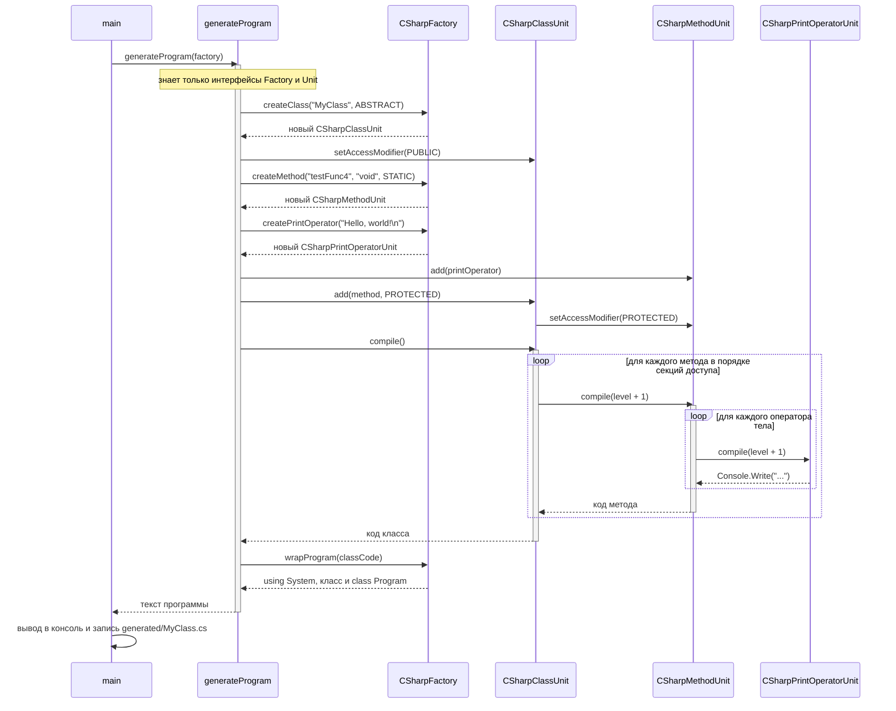

# Документация к лабораторной работе: генерация кода

Консольное приложение на C++, генерирующее исходный код класса на C++, C# и Java. Разработано в рамках курса «Технологии программирования» (4 курс, 2 семестр).

## Описание

Программа строит дерево элементов кода (класс → методы → операторы) и по нему генерирует законченную программу на каждом из трёх языков. Целевой язык определяется не на этапе компиляции, а во время выполнения — выбором конкретной фабрики. Для решения задачи применён паттерн «Абстрактная фабрика».

Исходный код генератора из задания размещён первым коммитом репозитория.

## Требования по заданию

1. Расширить исходную реализацию, чтобы генерировать программы не только на C++, но и на C# и Java.
2. Сгенерированные программы должны без ошибок компилироваться компилятором своего языка.
3. Добавить модификаторы классов и методов, которых нет в C++, но есть в C# и Java (`synchronized`, `transient`, `volatile` можно не включать).
4. Применить паттерн «Абстрактная фабрика».

## Технологии

- C++17
- CMake 3.16
- MinGW-w64 (GCC)

## Структура проекта

```
code_generator/
├── main.cpp               точка входа: generateProgram и генерация на трёх языках
├── unit.h                 базовый элемент синтаксиса Unit
├── classunit.h            абстрактный элемент «класс»
├── methodunit.h           абстрактный элемент «метод»
├── printoperatorunit.h    абстрактный элемент «оператор печати»
├── factory.h              абстрактная фабрика Factory
├── cppfactory.h/.cpp      элементы и фабрика C++
├── csharpfactory.h/.cpp   элементы и фабрика C#
├── javafactory.h/.cpp     элементы и фабрика Java
├── docs/                  исходники UML-диаграмм (.mmd)
└── tests/                 эталоны и тест-кейсы
```

## Архитектура

- Абстрактные элементы
  - `Unit` — базовый элемент: `add` (добавление вложенного элемента), `compile` (генерация кода), модификатор доступа элемента
  - `ClassUnit` — класс: члены, сгруппированные по модификаторам доступа, и модификаторы класса
  - `MethodUnit` — метод: имя, тип, модификаторы и тело
  - `PrintOperatorUnit` — оператор печати строки
- Абстрактная фабрика
  - `Factory` — интерфейс создания элементов (`createClass`, `createMethod`, `createPrintOperator`) и обёртки программы (`wrapProgram`, `fileName`)
- C++: `CppFactory`, `CppClassUnit`, `CppMethodUnit`, `CppPrintOperatorUnit`
- C#: `CSharpFactory`, `CSharpClassUnit`, `CSharpMethodUnit`, `CSharpPrintOperatorUnit`
- Java: `JavaFactory`, `JavaClassUnit`, `JavaMethodUnit`, `JavaPrintOperatorUnit`

### Абстрактная фабрика

Функция `generateProgram(const Factory&)` собирает дерево элементов только через интерфейс `Factory` и абстрактные элементы и **не знает целевого языка**. Конкретная фабрика создаёт элементы своего языка, а каждый элемент сам генерирует код в синтаксисе этого языка:

| Фабрика         | Создаёт элементы | Обёртка программы                          | Файл           |
|-----------------|------------------|--------------------------------------------|----------------|
| `CppFactory`    | `Cpp*`           | `#include <cstdio>` и `int main()`         | `MyClass.cpp`  |
| `CSharpFactory` | `CSharp*`        | `using System;` и `class Program { Main }` | `MyClass.cs`   |
| `JavaFactory`   | `Java*`          | -                                          | `MyClass.java` |

Чтобы добавить новый язык, достаточно создать наследников `ClassUnit`, `MethodUnit`, `PrintOperatorUnit` и `Factory` и добавить фабрику в `main`; `generateProgram` при этом не меняется.

### Модификаторы

Флаги задаются один раз для всех языков; каждый элемент переводит их в синтаксис своего языка, а модификаторы, которых в языке нет, отбрасывает.

**Модификаторы доступа** (`ClassUnit::AccessModifier`) — для членов класса и для самого класса (`setAccessModifier`):

| Флаг                 | C++          | C#                   | Java            |
|----------------------|--------------|----------------------|-----------------|
| `PUBLIC`             | `public:`    | `public`             | `public`        |
| `PROTECTED`          | `protected:` | `protected`          | `protected`     |
| `PRIVATE`            | `private:`   | `private`            | `private`       |
| `INTERNAL`           | `public:`    | `internal`           | package-private |
| `PROTECTED_INTERNAL` | `protected:` | `protected internal` | `protected`     |
| `PRIVATE_PROTECTED`  | `protected:` | `private protected`  | `private`       |

**Модификаторы класса** (`ClassUnit::Modifier`):

| Флаг       | C++     | C#         | Java       |
|------------|---------|------------|------------|
| `ABSTRACT` | -       | `abstract` | `abstract` |
| `FINAL`    | `final` | `sealed`   | `final`    |

**Модификаторы метода** (`MethodUnit::Modifier`):

| Флаг       | C++                        | C#         | Java       |
|------------|----------------------------|------------|------------|
| `STATIC`   | `static`                   | `static`   | `static`   |
| `CONST`    | `const`                    | -          | -          |
| `VIRTUAL`  | `virtual`                  | `virtual`  | - (методы виртуальны по умолчанию) |
| `ABSTRACT` | `virtual ... = 0`          | `abstract` | `abstract` |
| `FINAL`    | `final` (только у virtual) | -          | `final`    |

Добавлены по заданию (в C++ их нет): `internal`, `protected internal`, `private protected` (C#), package-private (Java), модификатор доступа у класса, `abstract` у класса и метода, `sealed` у класса (C#).

## Сборка

### CMake

```bash
mkdir build && cd build
cmake ..
cmake --build .
```

## Использование

```bash
./code_generator
```

Программа печатает сгенерированный код на трёх языках в консоль и сохраняет его в папку `generated` текущего каталога (`MyClass.cpp`, `MyClass.cs`, `MyClass.java`). Входные данные генерации задаются в функции `generateProgram` в `main.cpp`.

## UML-диаграммы

Исходники диаграмм лежат в папке [`docs`](docs).

### Диаграмма классов

Исходник: [`docs/class_diagram.mmd`](docs/class_diagram.mmd)

```mermaid
classDiagram
    class Unit {
        <<abstract>>
        #m_accessModifier : int
        +add(unit : Unit, flags : Flags) void
        +compile(level : unsigned int) string*
        +setAccessModifier(accessModifier : int) void
        #generateShift(level : unsigned int) string
    }

    class ClassUnit {
        <<abstract>>
        #m_name : string
        #m_flags : Flags
        #m_fields : map~int, Fields~
        +ClassUnit(name : string, flags : Flags)
        +add(unit : Unit, flags : Flags) void
    }

    class MethodUnit {
        <<abstract>>
        #m_name : string
        #m_returnType : string
        #m_flags : Flags
        #m_body : vector~Unit~
        +MethodUnit(name : string, returnType : string, flags : Flags)
        +add(unit : Unit, flags : Flags) void
        #compileBody(level : unsigned int) string
    }

    class PrintOperatorUnit {
        <<abstract>>
        #m_text : string
        +PrintOperatorUnit(text : string)
    }

    class Factory {
        <<interface>>
        +createClass(name : string, flags : Flags) ClassUnit
        +createMethod(name : string, returnType : string, flags : Flags) MethodUnit
        +createPrintOperator(text : string) PrintOperatorUnit
        +wrapProgram(classCode : string) string
        +fileName() string
    }

    class CppFactory
    class CSharpFactory
    class JavaFactory

    class CppClassUnit {
        +compile(level : unsigned int) string
    }
    class CSharpClassUnit {
        +accessModifierToString(accessModifier : int) string$
        +compile(level : unsigned int) string
    }
    class JavaClassUnit {
        +accessModifierToString(accessModifier : int) string$
        +compile(level : unsigned int) string
    }

    class CppMethodUnit {
        +compile(level : unsigned int) string
    }
    class CSharpMethodUnit {
        +compile(level : unsigned int) string
    }
    class JavaMethodUnit {
        +compile(level : unsigned int) string
    }

    class CppPrintOperatorUnit {
        +compile(level : unsigned int) string
    }
    class CSharpPrintOperatorUnit {
        +compile(level : unsigned int) string
    }
    class JavaPrintOperatorUnit {
        +compile(level : unsigned int) string
    }

    Unit <|-- ClassUnit
    Unit <|-- MethodUnit
    Unit <|-- PrintOperatorUnit
    ClassUnit "1" o-- "0..*" Unit : m_fields
    MethodUnit "1" o-- "0..*" Unit : m_body

    ClassUnit <|-- CppClassUnit
    ClassUnit <|-- CSharpClassUnit
    ClassUnit <|-- JavaClassUnit
    MethodUnit <|-- CppMethodUnit
    MethodUnit <|-- CSharpMethodUnit
    MethodUnit <|-- JavaMethodUnit
    PrintOperatorUnit <|-- CppPrintOperatorUnit
    PrintOperatorUnit <|-- CSharpPrintOperatorUnit
    PrintOperatorUnit <|-- JavaPrintOperatorUnit

    Factory <|.. CppFactory
    Factory <|.. CSharpFactory
    Factory <|.. JavaFactory
    CppFactory ..> CppClassUnit : create
    CppFactory ..> CppMethodUnit : create
    CppFactory ..> CppPrintOperatorUnit : create
    CSharpFactory ..> CSharpClassUnit : create
    CSharpFactory ..> CSharpMethodUnit : create
    CSharpFactory ..> CSharpPrintOperatorUnit : create
    JavaFactory ..> JavaClassUnit : create
    JavaFactory ..> JavaMethodUnit : create
    JavaFactory ..> JavaPrintOperatorUnit : create
```



Обозначения: `<|--` — обобщение (наследование), `<|..` — реализация интерфейса,
`o--` — агрегация (элемент хранит вложенные элементы), `..>` — зависимость (фабрика создаёт элемент);
в кавычках указана кратность концов связей.

### Диаграмма последовательности

Сценарий «генерация программы на C#»: `generateProgram` создаёт элементы только через фабрику, каждый элемент генерирует свой код. Для C++ и Java сценарий тот же, меняются только классы элементов. Исходник: [`docs/sequence_diagram.mmd`](docs/sequence_diagram.mmd)



## Тестирование

Пользовательские тест-кейсы и эталонные результаты описаны в [`tests/README.md`](tests/README.md).
